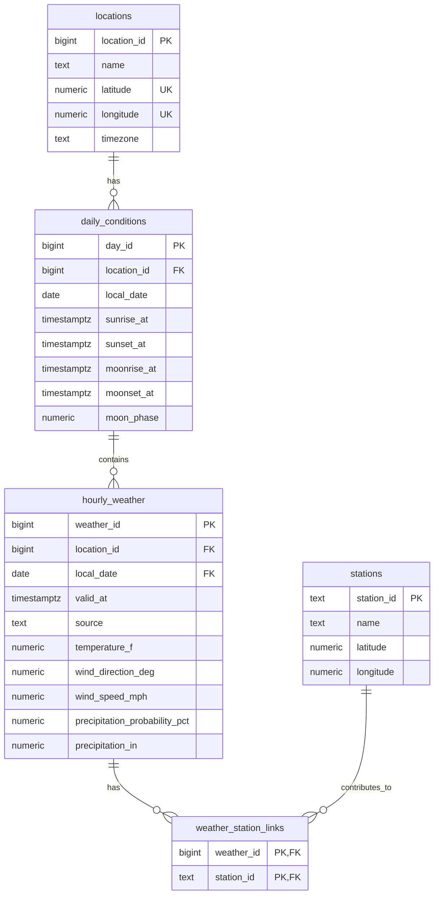

# Weather database design — Milestone 2

Draft for student review. This document and `db/schema.sql` describe the
proposed design; they do not prove that tables have been created or populated.
Based on the saved collection described in `docs/data_dictionary.md`.

All five tables also contain `first_seen_at` and `last_updated_at`, both
`timestamptz NOT NULL DEFAULT now()`. They are omitted from the diagram for
readability. Diagram uniqueness markers on location coordinates refer to the
**pair**, not to either coordinate independently.

## What one row means

- **locations:** One requested weather location, with resolved coordinates and
  its IANA timezone. Marquette is the requested place, not a weather station.
- **daily_conditions:** One local calendar day at one location, with daily
  astronomy. `(location_id, local_date)` is unique; missing moon events stay null.
- **hourly_weather:** One absolute hour at one location, represented by the
  current stored observation or forecast. `(location_id, valid_at)` is unique.
- **stations:** One provider weather station. Its text station ID is the natural
  primary key, which also guarantees uniqueness without a redundant constraint.
- **weather_station_links:** One association between an hour and a listed
  contributing station. Its two-column primary key prevents repeated links.

## Relationships and a debated design choice

One location has many days, and one day contains many hourly records. The hour's
`(location_id, local_date)` foreign key references that exact location/day pair;
therefore an hour cannot reference a nonexistent day. The loader must derive
`local_date` in the location's timezone and check it against the parent day.

We considered storing one station ID on each hour, but the API can list multiple
stations for one hour. A linking table preserves that many-to-many relationship
without duplicating weather measurements. Forecast hours can have **zero** station
links; absence does not mean those forecasts should be discarded.

## Time, units, and missing data

Convert hourly epoch timestamps to timezone-aware instants for `valid_at`.
Use the location's timezone for local calendar dates and local sunrise/sunset
values, preferring supplied epoch fields where available. PostgreSQL
`timestamptz` stores an instant; the location's timezone is stored separately.
Repeated local clock hours during daylight saving time remain distinct.

Measurements use the collection's US units: degrees Fahrenheit, miles per hour,
and inches. Wind direction is the direction wind comes **from**, in degrees.
The loader must verify units rather than silently mix unit systems.

Checks enforce coordinate ranges, nonnegative wind/precipitation, percentages
from 0 to 100, and moon phase from 0 to 1. Missing measurements remain SQL NULL,
not zero. Source categories are currently restricted to the verified `obs` and
`fcst` values; unexpected categories must be reported for review, not relabeled.
Historical precipitation probability is not the original forecast probability.

## Duplicate prevention and audit limitations

Milestone 2 loading will use the unique keys with `ON CONFLICT DO NOTHING`.
This stores one version per location/hour, not a forecast-revision archive.
If both an observation and forecast exist for the same hour in the input, the
loader should prefer the observation deterministically. Milestone 3 must define
updates for refreshed forecasts and their replacement by observations.

Audit timestamps mean **first database insertion** and **last stored update**;
they do not establish API retrieval time or forecast issue time. Defaults only
initialize them; later update code must advance `last_updated_at` explicitly.
Daily astronomy likewise represents a single stored version for the location/day.

## Applying the design

The SQL wraps table creation in a transaction so an error does not leave a
partially created design. It contains no DROP statements or passwords. Do not
run it until reviewed. Applying it creates tables; it does not load weather,
create access roles, or implement scheduled syncing.
